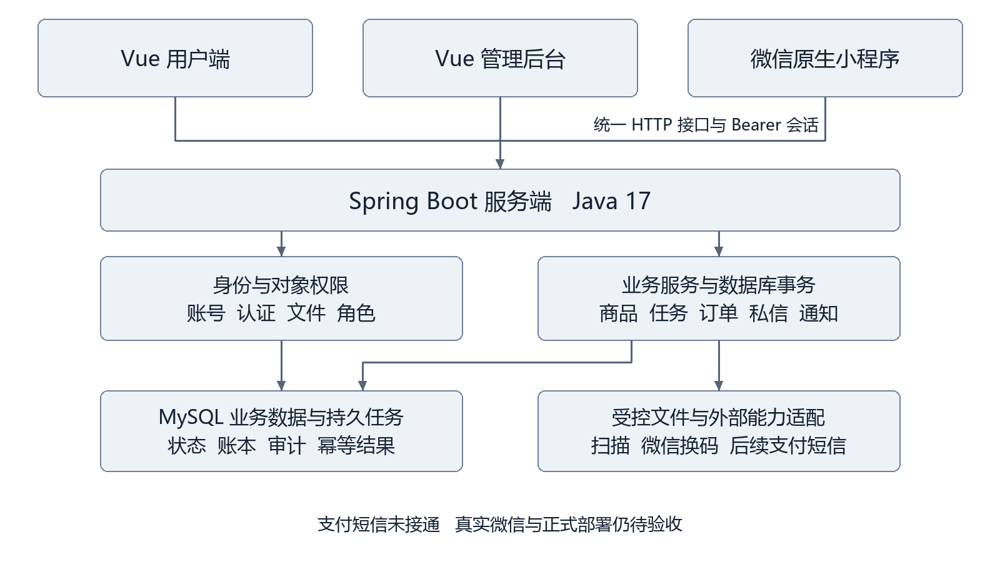
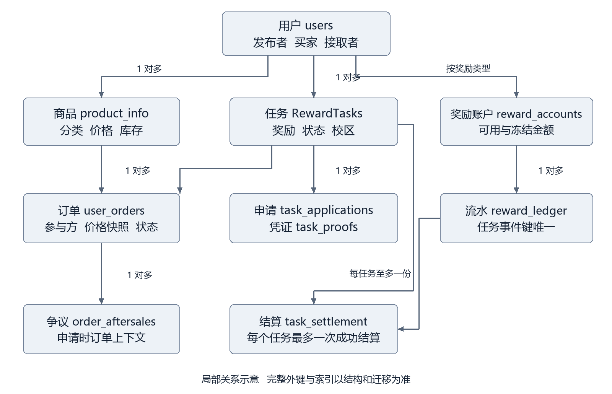
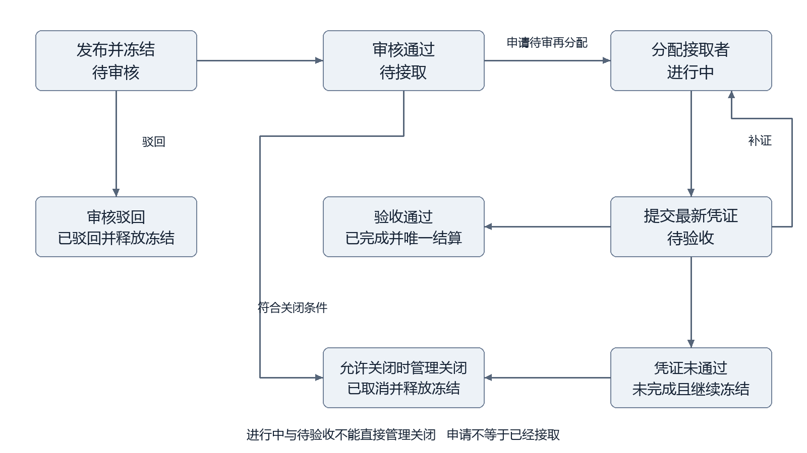

# 校园Π校园信息共享平台软件工程设计报告

软件工程项目设计与实现答辩材料

学校：浙江财经大学东方学院

项目组：校园Π九人协作项目组

指导教师：待填写

答辩日期：待填写

编写日期：2026年10月24日

本报告依据仓库中的设计报告修订版、接口契约、当前源代码和实际验证记录编写，用于说明系统如何设计、哪些业务已经落地，以及现场如何证明实现结果。它对应本次提交的项目版本，不将原型图、人工测试数据或尚未接入的外部能力记为已完成功能。原设计报告保留，供查看完整原始业务流程和界面参考。

## 摘要

校园Π面向校园二手物品流通、悬赏互助和校园信息交流，将账号认证、内容审核、任务履约、订单记录、私信举报及站内通知组织到同一平台。项目采用 Java 17 和 Spring Boot 构建服务端，使用 Vue 构建 Web 用户端及管理后台，并提供微信原生小程序。多个客户端通过统一接口访问业务，身份、权限、状态转换与资金校验均由服务端决定。

本次实现的核心是可验证的业务过程：商品订单创建与库存预占、任务发布冻结奖励、管理员审核分配、接取者提交凭证、审核后唯一结算，以及审核结果经过偏好过滤后持久投递。前端通过公共布局、表单、分页与文件预览减少重复实现，小程序进一步复用公共业务组件，并处理窄屏换行、输入框裁字和底部安全区问题。

本机验证包括 Java 事务与接口测试、Node 逻辑测试、Vue 构建、微信官方独立编译及浏览器布局检查。真实支付与商品退款、现金渠道、短信找回、真实微信换码、完整真机验收及正式部署仍有未完成事项。数据分析图表使用标明来源的 JSON 模拟数据，不能用于证明真实运营效果。本报告据此给出实现说明、证据边界和答辩演示方案。

关键词：校园信息共享；任务状态机；数据库事务；幂等；组件复用；移动端适配

## 1 项目背景与设计目标

### 问题与目标

校园商品、互助任务与交流信息往往分散在不同入口。信息发布者需要管理内容和处理反馈，参与者需要确认对方身份、了解处理状态，管理员需要审核、追踪并保留操作依据。本项目围绕这些过程建立统一的数据和交互入口，不使用未经调查的用户增长、收入或效率提升数值作为项目成果。

设计目标包括统一账号与校园认证；支持商品、帖子和任务的发布及查询；明确任务申请、分配、履约、验收和结算的顺序；为管理员提供审核、用户状态、订单、举报和通知管理；为关键写操作保留审计及失败恢复依据。用户端与管理端共用服务端规则，避免客户端各自解释状态和权限。

### 实现范围

|领域|本次实现|答辩时需要说明的边界|
|---|---|---|
|账号与认证|密码登录、注册、资料、改密、会话、实名与校园审核、受控文件|短信找回未接通；正式人员与校区授权待配置|
|商品与帖子|发布、查询、编辑、收藏、分类及管理员审核|信用、推荐、评论点赞等扩展未完整实现|
|悬赏任务|冻结奖励、审核、申请、分配、凭证版本、验收、积分结算、日志|现金渠道默认关闭；没有自行充值或注册赠送积分|
|商品订单|可信价格快照、库存预占、订单查询及取消释放|真实支付、商品收货履约与退款未完成|
|沟通与通知|文本图片私信、已读、举报、通知偏好、审核通知、持久投递|私信采用轮询；未接外部短信邮件与系统级推送|
|统计与多端|真实基础指标和待办、JSON 模拟图表、Web 与小程序业务入口|模拟图表不是生产统计；完整真机验收待完成|

## 2 需求分析

### 参与角色

访客可访问允许公开的内容，但不能通过伪造用户编号执行写操作。普通用户登录后管理本人资料、提交认证、发布内容、收藏、申请任务、下单和私信。认证状态和校区资格影响具体业务权限，不能用页面隐藏按钮代替这些校验。

管理员执行内容审核、任务分配与验收、用户状态管理、订单及举报处理。敏感职责进一步控制认证材料查看、权限授予和通知发布等操作。正式职责名单属于部署配置；本机测试管理员拥有的权限不代表所有管理员都应自动获得相同职责。

### 功能需求与验收条件

|模块|输入与主要处理|输出及验收要点|
|---|---|---|
|A 账号与权限|账号凭据、资料修改、用户启停用|签发会话；改密或停用后旧会话失效；拒绝自停用等危险操作|
|B 认证与文件|实名校园申请、真实上传、审核理由|本人申请记录；授权预览；审核审计；越权读取被拒绝|
|C 商品与分类|商品描述、价格、图片、分类、收藏|待审或可售商品；编辑重新进入相应审核流程；收藏不重复|
|D 帖子与概览|帖子正文、公开范围、管理查询|帖子列表详情及本人管理；基础统计读取实际数据库|
|E 任务发布接取|任务奖励、认证校区、接取申请|发布时冻结；申请不直接占得任务；审核后仅一人被分配|
|F 凭证与结算|实际接取者的说明及证据、管理员结论|保留凭证版本；完成后仅结算一次；补证不提前发奖|
|G 订单与争议|商品数量、自提地点、任务争议原因|可信订单与库存；取消释放；任务零金额争议不擅自改变资金|
|H 私信与举报|会话、文本图片、已读和举报|仅参与者可读；本人侧删除；管理员保留处理证据|
|I 通知与偏好|发布草稿、目标、偏好、免打扰时段|关闭则不接收；免打扰后投递；安全通知同样遵守偏好|

### 非功能需求

一致性要求关注奖励、库存、订单和审核日志的共同提交，出现任何必要写入失败时回滚。安全性要求服务端检查身份、职责和对象归属，密码使用不可逆哈希，上传文件扫描后才能进入受控使用流程。可维护性要求同一客户端复用请求、表单、分页、布局和状态组件，接口及迁移有明确责任归属。

可靠性通过幂等键、数据库唯一约束、持久任务和重试机制支持。可用性通过加载状态、错误反馈、禁止重复提交、窄屏换行及安全区避让改善。上述内容是设计目标及已经覆盖的实现措施，项目没有取得生产压测、持续可用率或高并发容量认证，不据此宣称能够支撑某个规模的线上用户。

## 3 系统总体设计

### 技术选择

|层次|采用技术|在本项目中的用途|
|---|---|---|
|服务端|Java 17、Spring Boot 3.5.16|HTTP 路由、参数校验、身份拦截、事务与后台任务|
|数据访问|Spring JDBC 事务与 MySQL|关键业务使用参数绑定、行锁和服务事务；工程另有 MyBatis Plus 依赖|
|Web 客户端|Vue 3.5.44、Vite 8.3.4|用户业务与管理后台，共享请求和业务控件|
|微信客户端|原生 WXML、WXSS、JavaScript|微信导航、公共业务组件、上传和账号绑定入口|
|安全与文件|Argon2id、受控文件引用、扫描适配|密码哈希、私密材料授权、图片及材料校验|
|开发验证|Maven、Node、Python、MySQL 独立测试库|构建、契约检查、白盒测试、HTTP 与人工验收|

### 架构与调用关系

图 1 系统总体架构与外部依赖边界

系统采用模块化单体服务端。Vue 用户端、Vue 管理后台和微信小程序通过统一的 `/api/v1` 接口访问 Spring Boot；客户端不能直接访问数据库。控制器负责 HTTP 输入输出，身份服务确定当前操作者，业务服务负责资格、状态和事务，数据库保存最终业务事实。后台工作线程从持久任务表读取通知或批量任务，不依赖某次页面请求持续存活。

文件扫描和微信换码是独立的外部能力。文件经过服务端校验及授权后提供给允许的读者；微信临时 code 由服务端换取身份，客户端不能提交可信 openid 替代换码。支付与短信尚未建立真实闭环，在架构中作为后续依赖，不参与当前成功演示链路。

### 模块边界与协作

A 负责公共请求和鉴权，D 负责布局导航，B 负责受控文件，E 提供任务主详情，F 提供履约与结算，G 汇总数据库迁移顺序。每位成员以业务模块完成前后端、相关数据库变更和联调，不另外建立九套工程。当前责任表仍有待认领项，本报告不推定真实个人贡献比例。

共同修改的内容包括任务状态、奖励账户、订单、文件权限和共享布局。接口变更需同步契约与调用方，数据库变更需追加迁移并在独立空库和已有结构上检查。main 是集成分支，个人分支通过可审查提交集成，真实私有配置不进入 Git。

## 4 数据库设计

### 数据模型与迁移

设计基线含 25 张表、12 个存储过程和4个触发器。应用随后通过 V001 至 V008 增量迁移增加会话、文件、业务编号、通知持久队列、批量操作和微信绑定等结构；全部迁移后的独立验证库为40张表。两个数量表示不同阶段，不能以新增表为由直接改写历史基线。原存储过程用于设计与独立数据库验证，当前关键业务执行服务层事务，不把内部 COMMIT 的过程再包装进另一套事务。

|数据域|主要表|关键关系或约束|
|---|---|---|
|身份与权限|users、user_verification、auth_sessions、account_wechat_bindings|账号关联认证及会话；同一 AppID 下微信与校园账号绑定唯一|
|商品与帖子|category、product_info、product_media、product_favor、post_info、post_collection|商品关联分类、卖家与图片；用户收藏关系唯一|
|任务与履约|RewardTasks、task_applications、task_proofs、task_audit_log|发布者与实际接取者分离；申请唯一；凭证版本保留|
|奖励与结算|reward_accounts、reward_ledger、task_settlement|按用户与奖励类型区分账户；事件键和任务结算唯一|
|订单与争议|user_orders、order_aftersales、aftersale_order_context|订单记录参与方与价格快照；争议保留申请时上下文|
|沟通与通知|t_chat_session、t_private_msg、t_msg_report、notification_receipts、notification_outbox|会话参与方约束；用户侧状态独立；持久投递可恢复|
|管理与文件|admin_audit_log、business_files、business_file_bindings、admin_batch_jobs、admin_batch_items|记录操作和文件用途；批次与逐项结果分开保存|

### 核心实体关系

图 2 任务履约及商品订单的主要关系

图中仅保留答辩所需的主关系，完整字段、外键和索引以数据库结构及迁移为准。任务可以有多名申请者和多版凭证，但同一时刻只有一个实际接取者，成功结算只能存在一份。商品订单在下单时保存可信单价、数量与总额，后续查询不随商品编辑重新计算历史订单金额。

### 数据一致性设计

金额使用数据库定点数和 Java BigDecimal 计算，不使用浮点数累计资金。任务发布时同时写入任务、冻结余额和冻结流水；结算同时更新双方账户、任务、订单、唯一结算和日志。判断冻结是否属于当前任务时检查该任务的冻结事件，不能仅看到用户冻结总额足够就扣款。

库存检查与预占位于锁定商品的同一事务内。任务分配和凭证审核先锁定相应业务行，再复核资格、最新状态和版本。唯一索引是防止重复申请、重复订单或重复结算的最终保护，与服务端业务判断共同使用。列表总数和分页内容使用相同筛选条件，日期筛选按北京时间自然日转换为 UTC 左闭右开区间。

## 5 接口与安全设计

### 接口约定

接口基线定义112项操作，责任分配唯一；其中 P0 为104项、P1 为8项。这个数字是设计契约的数量，不等于112项都已经实现并通过验收。微信4项扩展、全局审核与投递记录查询及 PUT 资料兼容入口另有补充文档，保留原接口编号。私密响应禁止缓存，统一响应包括 `code`、`message`、`data` 和 `request_id`。

|示例路径|用途|关键约束|
|---|---|---|
|POST /auth/login|账号密码登录|服务端签发随机 Bearer 会话，不接受客户端指定角色|
|PATCH 或 PUT /me|修改本人资料|PUT 复用原 PATCH 校验与事务；不修改他人资料|
|POST /products|发布商品|认证、分类及图片引用有效，身份取自会话|
|POST /tasks|发布悬赏|奖励大于零；校区资格和余额通过后冻结|
|POST /tasks/{id}/applications|提交接取申请|不能申请本人任务；重复申请被约束|
|POST /tasks/{id}/proofs|提交履约凭证|必须为实际接取者；任务订单快照和状态一致|
|POST /orders/product|创建商品订单|使用服务端商品价格，锁定并预占库存|
|GET /admin/task-audit-logs|全局任务审核记录|管理员身份、日期与分页校验|
|GET /admin/notification-deliveries|全局通知投递记录|管理员及通知发布专项职责|
|POST /me/wechat|主动绑定微信|仅接收新 code；重新检查当前会话和唯一绑定|

以上表格省略共同前缀 `/api/v1`。完整参数、业务码和响应结构以 OpenAPI 及接口补充为准。典型错误包括400参数错误、401会话失效、403权限不足、404对象不可见、409状态冲突、429限流和501功能未启用。尚未配置的外部能力返回明确限制，不返回模拟成功。

### 身份与权限

密码使用 Argon2id 哈希保存。登录成功生成32字节随机不透明令牌，数据库存储令牌摘要；它不是 JWT。会话绝对期限为2小时，闲置期限为30分钟，改密、停用和退出均影响既有会话。客户端当前以内存保存令牌，刷新或冷启动后可能需要重新登录，尚未实现长期记住登录。

服务端从 Bearer 确定操作者，再判断角色、专项职责、本人关系和校区资格。对象访问按最小可见范围返回，公开资料不泄露认证材料、私信或未公开任务。SQL 条件使用参数绑定；页面按钮的显示、禁用和路由守卫只改善操作体验，不能成为安全边界。

### 幂等与批量操作

写操作按契约携带 Idempotency-Key。同一操作者、同一操作、同键同内容重放可以恢复已保存的结果；相同键但内容不同应冲突。前端在失败重试时保留同一操作的键，成功后释放，减少网络响应丢失造成的重复写入。唯一约束和状态复核仍然需要保留，因为不同键也可能竞争同一业务对象。

批量用户启停用及内容审核遵守已经确认的规则：逐条独立处理，成功项保留，失败项列明原因。批次和单项结果持久化，页面可以重新查看；不能使用一个大事务让最后一条失败撤销此前全部成功，也不能吞掉失败项只显示整批成功。

### 文件与微信身份

文件用途区分认证材料、头像、商品图片和任务凭证。上传、扫描、业务绑定与读取授权由服务端执行，前端只持有受控引用。历史测试图片中的 TEST_FIXTURE 标记只说明数据来源，不能作为真实杀毒记录；本机扫描适配不等同正式部署环境已经验收。

微信流程为已有校园账号密码登录后主动绑定。客户端每次取得新的 wx.login code，由服务端向微信换码；未绑定微信登录不会自动创建校园账号。同一 AppID 下绑定关系双向唯一。AppID、AppSecret、真实接口主机及私有数据库配置保持在被忽略文件或环境变量中。代码与测试替身已经存在，真实微信提供方仍待验证。

## 6 核心业务详细设计

### 账号认证与内容审核

注册只建立符合契约的账号，不自动赠送积分或完成认证。用户登录后分别提交实名与校园申请，上传必要证据；管理员在职责范围内审核。商品、帖子及任务的发布状态由服务端控制，审核成功后才按可见性规则进入公开列表。本人可查看自己被驳回或待审的内容，公开访问不能因此获得私有字段。

审核过程保存操作者、原因、对象和状态变化，并生成个人结果通知。业务变更与通知任务共同提交；如果关键审计或通知写入失败，事务回滚，避免出现界面显示审核成功而没有应有的操作证据。

### 悬赏任务状态机

图 3 悬赏任务的主要状态转换

|操作|前置状态|主要结果|
|---|---|---|
|用户发布|资格有效且余额充足|任务待审核；可用奖励转为冻结，写冻结事件|
|发布审核通过|待审核|进入待接取，奖励继续冻结|
|发布审核驳回|待审核|进入已驳回，本任务冻结奖励释放一次|
|提交申请|待接取|申请待审，任务仍待接取，不立即创建任务订单|
|管理员分配|任务待接取且申请待审|确定唯一接取者，任务进行中，创建任务订单|
|提交凭证|进行中且操作者为实际接取者|产生新凭证版本；任务与订单待验收|
|要求补证|待验收且审核最新待审版本|返回进行中；保留旧凭证；不结算|
|验收通过|待验收且全部一致性检查通过|任务与订单已完成，奖励转给接取者，保存唯一结算|
|管理关闭|允许关闭的待审核、待接取或未完成状态|任务已取消，释放冻结，同步申请及关联订单|

分配时重新检查双方资格和校区，防止发布后身份变化仍被旧页面绕过。通过后其他待审申请按既有规则处理，不能出现两个接取者。接取者提交凭证时校验关联订单的参与方、数量、金额快照和状态；验收时必须处理最新版本，不能拿旧截图重放结论。

进行中或待验收任务不能被普通管理关闭操作直接取消或重新分配。凭证未通过可进入未完成状态并继续冻结，由后续允许的管理流程处理。现金奖励默认关闭；演示中使用的数据来自独立合成测试账户，不能解释为已接入充值、提现或外部付款。

### 商品订单与库存

买家提交商品、数量和自提地点，服务端检查卖家、认证、商品状态及库存，读取可信单价并保存订单快照。创建时预占库存，取消时按业务状态释放。客户端篡改价格不影响服务端金额计算，不允许仅凭列表上一次看到的库存直接创建订单。

业务编号复用统一编号服务，在创建订单的事务中分配；编号回滚和业务回滚保持一致。真实支付、物流、确认收货、商品退款和对账不在本次成功闭环中。人工数据中预置的已付款或已退款记录只用于状态查询，演示不能把查询这些历史记录当成真实付款或退款成功。

### 任务争议与私信举报

已实现的任务争议为零金额申请、查询、撤回和管理员处理，保存申请时的订单上下文，不直接改变任务或奖励状态。商品退款需要可信支付、退款预占和对账规则，尚未实现。两类业务必须在界面和答辩中分清，不能统一说成完整售后退款系统。

私信会话由参与方确定，服务端决定消息接收者。支持文本、图片、未读计数、已读和单侧删除；单侧删除不等于为所有参与者销毁证据。用户可举报违规消息，管理员在权限范围内查看处理依据。当前页面每10秒检查新消息，没有实现 WebSocket 实时推送。

### 通知偏好与持久投递

通知包含管理员草稿、发布结果和业务审核自动通知。发布快照与待投递任务写入数据库，后台 worker 持续领取；进程重启后可从持久状态继续处理。接收者及内容快照不依赖管理员页面一直保持打开。失败可记录并按允许规则重试，重复处理不能生成重复收件记录。

偏好处理遵守负责人已确认的规则：关闭站内通知则不接收；处于免打扰时推迟到结束后投递；安全通知同样遵守偏好。人工测试环境默认关闭通知 worker，便于保留初始队列，因此仅看到队列记录不表示已经完成到期投递。现场演示到期投递前必须核对该测试环境 worker 已启用。

## 7 界面与移动端设计

### 原型与组件复用

界面视觉依据原 Word 报告中的原始图，保持手机端配色、管理后台深色侧栏和原有业务栏目。修订版补画的图不替代用户指定的原图。为完成原图未描述的凭证版本、争议及异常处理，需要增加相应交互，因此不宣称所有页面已经逐像素复刻。

管理端复用 WorkspaceLayout、公共工作区样式、FilePreview、批量操作组件及原有 AnalyticsPage 图表。Web 用户端复用导航、表单、分页、异步操作和状态提示。小程序以 business-surface 承接商品、帖子、任务等共同行为，通过业务服务选择字段与接口，避免相同页面分别维护另一套按钮、分页和错误逻辑。

### 本次移动适配修复

|发现的问题|实现修改|复核方式|
|---|---|---|
|工具栏按钮竖排或挤压|明确按钮内容宽度、最大宽度和可换行布局|六种宽度检查按钮位置及相互遮挡|
|分页分列错误、底栏遮挡|固定上一页与下一页的列宽；共享底部尺寸及安全区|长列表滚动到底，检查分页与底栏间隙|
|发布表单打开后旧标签仍高亮|公共模板按当前表单阶段与创建模式决定选中项|发布按钮高亮；取消或返回恢复原列表标签|
|搜索与表单输入文字被裁切|单行输入框高度96rpx，取消上下内边距，明确字体和行高|检查占位文字、中文数字及搜索按钮对齐|
|长标题、说明和选项显示不全|允许断行，移除摘要高度截断，编辑框原生自动增高|长中文、连续英文、多行说明与放大字体检查|

单行输入与多行编辑分开处理：单行控件保留正常编辑行为，多行控件随内容增高，避免固定容器截住内容。公共样式同时处理最小宽度、边框盒尺寸和底部安全区，避免在每个页面使用不同缩放比例补偿。126组浏览器布局检查只能证明夹具中的几何结果，真实微信键盘、光标及动态布局仍需要手机重新预览确认。

## 8 软件测试与验证

### 方法与环境

白盒测试检查校验分支、事务回滚、幂等恢复、异步上下文和状态机不变量。黑盒测试通过真实 HTTP 与本机 MySQL 验证身份、权限、状态冲突及结果；浏览器检查关注页面入口、操作过程和显示。小程序另使用明确标识的 wx 宿主适配器及微信官方独立编译器，区分业务逻辑验证、模板编译和真实客户端验收。

测试写入限定在项目核实过的独立本地数据库，使用合成账号和材料。集成测试会模拟微信提供方和部分外部能力，不把测试替身的成功当成外部平台已经接通。人工库与日常开发库分开，安装器遇到已有用户时拒绝覆盖，不在真实数据环境重放初始化脚本。

### 本次集成前检查

|检查|结果及范围|
|---|---|
|静态基线|45份资产、112项接口、九个责任模块一致；属于静态检查|
|共享配置隐私|共享文件及未忽略新文件检查通过；真实 AppID 与密钥不进入提交|
|Vue 生产构建|npm run build 通过，生成包供服务端打包使用|
|Java 17 完整验证|启用本地数据库集成测试的 clean verify 通过85项，0失败、0错误、0跳过|
|Node 白盒与分析数据|Web 与原生白盒9项、分析数据13项通过；另有公共组件宿主16项|
|HTTP 边界|20项通过，包括参数边界、普通用户越权、非法字段与统一错误结构|
|微信独立编译|10页、5组件、19份 WXSS 通过；不是完整开发者工具或真机验收|
|移动几何检查|六种宽度、三种模拟安全区及1至1.6倍模拟字体，共126组通过|
|人工验收材料|13个合成账号、全模块 SQL、117条用例；用例清单不等于全部通过|

本次单次 Java85项测试对应的 JaCoCo 全后端行覆盖率为56.49%，分支覆盖率为37.98%。历史记录中的98.16%行覆盖率来自当时额外 HTTP 场景聚合，执行集合不同，不能直接作为本次结果或据此比较覆盖率升降。覆盖率以随附集成验证记录中的范围为准。即使测试用例通过，也不能推出所有设计功能、外部依赖或生产条件已经完成。

### 典型失败与回归

|风险或问题|校验与修复|应该观察到的结果|
|---|---|---|
|重复或并发任务验收|任务行锁、最新版本、唯一结算与事件键|最多一次成功记账，其他请求恢复或冲突|
|篡改任务订单快照|提交凭证重新比较参与方、数量与奖励金额|409且不新增凭证或改变任务状态|
|切换私信仍出现旧消息|切换时清空上下文，迟到响应受请求序号约束|新会话不显示旧会话消息|
|旧401覆盖新账号|对比请求发出时和当前身份|迟到错误不清除新账号会话|
|筛选失败仍显示旧总数|失败时清理数据与分页总数|错误与当前空结果一致，不误导用户|
|组件卸载后启动轮询|异步完成前检查组件与身份仍有效|已卸载组件不恢复旧身份或启动计时器|
|微信并发请求偶发锁冲突|限流记录直接排他锁，绑定使用用户行及唯一约束|成功和限流数量符合窗口，拒绝覆盖成功绑定|
|文字裁切与摘要丢失|明确输入高度、换行及自动增高|浏览器夹具不裁字；真机再次人工复验|

### 未完成验收

尚未取得真实支付退款闭环、短信找回、真实微信换码、完整小程序真机链路、生产文件扫描与存储、正式域名 HTTPS、负载容量、备份恢复及正式部署验收。真实管理职责和校区名单也需要项目负责人配置。上述条件不会因接口、表结构或 CI 文件存在而自动满足。

## 9 运行部署与版本管理

### 环境与启动

开发环境需要 JDK 17、Maven、Node.js 22.12及以上，以及满足约束的 MySQL。先构建 Vue，再构建后端，使新前端资源进入 JAR。账号、数据库、扫描器与 worker 使用外部配置；仅复制共享模板不能得到可用真实凭证。版本和具体命令见仓库 README 与本地开发指南。

Web 用户入口为 `/login`，管理入口为 `/admin/login`。本机日常服务使用8080，人工验收服务使用8082，其专用测试库位于33321端口。手机不能使用电脑的127.0.0.1作为远程服务地址；真机需要能够访问的服务地址及微信合法域名配置。完整页面操作见《校园Π页面测试使用手册》。

新空库依次执行初始结构、核心事务和已登记迁移。已有库只执行适用的增量变更，不能重导整份测试数据。人工 SQL 为专用测试数据脚本，安装工具另负责建结构和还原图片。管理员短口令 admin 与123456仅供明确配置的本机测试账号，正式部署应重新配置凭据和职责。

### Git 与交付

代码先保存在个人分支 wlky，经检查推送后合并 main。仓库提供 GitHub Actions 验证配置，覆盖静态检查、Vue 构建、一次性 MySQL 初始化及 Java 测试；配置存在本身不代表本次远程执行成功，实际结果应查看对应提交的工作流。提交排除 node_modules、dist、target、.local、本机微信配置和真实用户材料。

正式发布还应配置环境密钥、最小数据库权限、HTTPS、文件存储与扫描策略、日志告警、备份恢复和回滚流程。当前 main 合并表示代码集成，不表示已经上线或完成这些运维条件。

## 10 结果分析与后续工作

项目已经形成从内容发布到审核、从任务申请到验收结算、从沟通举报到通知反馈的核心应用实现，并以服务事务、唯一约束和幂等控制关键数据。多端前端复用共同组件，后续改变按钮、分页或输入样式时可以在公共位置修复，减少页面间漂移。

目前最明显的限制集中在外部能力和验收：商品交易缺少真实支付与退款，现金和正式积分来源未定义，真实微信及真机链路未完成，分析图表仍为 JSON 模拟。原报告中的推荐、信用、活动、评论点赞、全局搜索、系统设置及帮助反馈等扩展也没有全部落地。答辩应通过可运行核心流程证明已有工作，并将这些内容列为后续计划。

后续顺序建议为先完成真机布局和核心导航验收，再确认正式职责与校区、部署域名及文件能力；支付与退款在选定供应商并明确可信回调、对账和异常恢复后实施；最后定义统计指标及扩展功能。这个顺序反映当前依赖，不承诺未经确认的上线时间。

## 11 答辩演示方案

### 演示准备

使用独立人工测试库和已准备的13个合成账号。提前启动8082服务，确认管理员与普通用户可登录、测试 PNG 可上传、后端连接正确。浏览器刷新后会话可能丢失，应重新登录。不要现场使用真实个人认证材料或公开私有配置。通知到期演示前确认人工环境 worker 状态；微信未完成真实换码时，使用已经验证的密码登录路径说明现状。

### 八分钟演示顺序

|时间|操作|讲解重点|
|---|---|---|
|第1分钟|展示架构及范围表|三个客户端共享一个服务端，当前核心功能与未完成边界|
|第2分钟|普通用户登录，查看认证与个人信息|会话、对象归属、受控文件及真实资料|
|第3分钟|发布一条任务，管理员审核通过|发布即冻结，审核日志和通知共同提交|
|第4分钟|另一认证用户申请，管理员分配|申请与分配分离；唯一接取者与任务订单|
|第5分钟|接取者提交图片凭证，管理员验收|版本、资格和快照复核，唯一结算与流水|
|第6分钟|查看商品并创建和取消自提订单|可信价格、库存预占和释放；明确支付未接入|
|第7分钟|展示通知偏好及批量成功失败结果|持久任务、免打扰、逐项独立处理|
|第8分钟|展示测试记录和移动端修复|85项 Java 验证、126组布局；真机和外部依赖边界|

如果时间不足，优先展示完整任务流程和一个失败分支，例如余额不足、重复验收或无权限查看凭证。演示者应说明操作者、输入、状态变化及最终数据库结果，不只展示按钮或预置完成状态。

### 常见提问与回答依据

|可能的问题|建议回答|
|---|---|
|为什么选择模块化单体|九人围绕同一业务数据协作，当前先保证事务与接口清晰；尚无证据需要承担微服务部署和跨服务一致性成本|
|如何防止重复发奖|业务行锁与状态版本检查先限制操作，再由任务唯一结算和流水唯一事件键兜底，客户端重试使用幂等键|
|JWT 为什么没有出现|本项目采用数据库保存摘要的不透明会话，便于退出、停用与改密后撤销，不应讲成 JWT 方案|
|两个人同时接任务怎么办|提交申请不代表接取成功；管理员分配时锁任务并复核，最终只能确定一名接取者|
|订单金额可以由前端传吗|前端提交商品与数量，服务端读取可信价格并保存快照，不依赖客户端金额|
|免打扰期间通知会丢吗|按确认规则延后到免打扰结束再投递；关闭则不接收，安全通知也遵守|
|微信小程序已经正式接通吗|公共组件与服务接口已有实现和编译证据，真实换码、完整导航与真机验收仍待完成，不能说已经上线|
|数据分析数字是否真实|控制台基础指标与待办来自数据库，趋势和分类图表仍是标明来源的 JSON 模拟|
|117条人工用例是否全通过|它们是人工输入和预期矩阵，包含未启用能力的拒绝测试，不等于117项全部验收通过|
|与原型是否完全一致|沿用原 Word 视觉基准，补充必要交互并修复响应式问题；仍有原型业务差异，不能声称逐像素和全部功能一致|
|每位同学做了什么|按A至I任务书和实际 Git 提交及验收材料说明，未认领或未登记的贡献不编造|

## 12 资料与证据索引

|编号|仓库资料|用途|
|---|---|---|
|1|docs/design/校园Π软件工程设计报告修订版.docx|原设计、业务流程、数据字典和界面参考|
|2|docs/api/campus-pi-openapi.json 及接口开发规范|112项基线操作、参数和责任边界|
|3|docs/api/wechat-openapi.json 及微信接口补充|4项微信扩展与主动绑定规则|
|4|database/schema.sql 与 migrations|初始结构、设计过程和V001至V008增量|
|5|backend/src/main/java/com/campuspi|当前身份、业务、审核、投递及批量实现|
|6|frontend/src/member、admin 和 analytics|Web 业务、管理公共组件及模拟图表|
|7|miniprogram/components/business-surface|原生公共业务界面和移动适配实现|
|8|docs/development/2026-10-23缺项补齐与人工测试.md|最新核心补齐与历史运行证据|
|9|docs/verification/2026-10-23黑白盒测试报告.md|测试方法、问题和修复记录的历史快照|
|10|docs/verification/2026-10-23小程序宽度适配.md|移动端问题、126组检查及真机复验步骤|
|11|docs/verification/校园Π页面测试使用手册.md|每个页面入口、使用步骤与预期结果|
|12|docs/verification/人工测试数据手册.md 及人工测试矩阵|13个合成账号、测试数据与117条人工用例|
|13|docs/verification/2026-10-23集成发布验证.md|本次构建、覆盖率和发布验证边界|

本报告引用项目自身可复核资料，没有引入未经核验的市场调查、生产指标、论文结论或政策效果作为成果。指导教师、正式答辩日期及成员认领信息在确认后补充。
